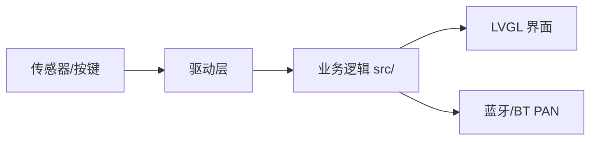

# 方案设计说明

| 项 | 内容 |
|---|---|
| 文档编号 | DOC-02 |
| 项目名称 | <项目名称> |
| 版本 / 状态 | v0.1 / 草稿 |
| 负责人 / 日期 | <姓名> / <YYYY-MM-DD> |

## 修订记录

| 版本 | 日期 | 修改人 | 修改内容 | AI参与 |
|---|---|---|---|---|
| v0.1 | <日期> | <姓名> | 创建 | 否 |

> 写作提示：设计要能回答“每条需求由哪个模块实现、怎么验证”。设计变更时先改本文档再改代码，并更新 `adr/`。

## 1. 设计输入

- 需求来源：`01-需求规格说明.md`（版本 v<x.y>）
- 硬件平台：黄山派 SF32LB525UC6，板型 sf32lb52-lchspi-ulp；SDK 版本：v2.5.1（课程统一）
- 约束：<例：无 WiFi；Flash/RAM 上限；功耗预算>

## 2. 总体架构

> 画一张图（Mermaid 或手绘拍照放 `docs/img/`），标出模块划分与数据流向，并能对着图逐块讲清职责。

## 3. 模块划分与需求追踪

| 模块 | 职责 | 对外接口 | 实现的需求 | 代码路径 | 测试 |
|---|---|---|---|---|---|
| <例：debounce> | <按键消抖> | `debounce_update()` | REQ-001 | `src/debounce.c` | TC-001 |
| <例：rgb_led> | <RGB 灯颜色与闪烁> | `rgb_led_set_color()` | REQ-002 | `src/main.c` | TC-002 |

## 4. 接口设计

### 4.1 软件接口

| 接口 | 输入 | 输出 | 错误处理 | 说明 |
|---|---|---|---|---|
| <函数/消息> | | | | |

### 4.2 数据结构与状态机

<关键结构体、状态转移表/图>

## 5. 硬件资源分配

| 外设 | 用途 | 引脚/总线 | 参数 | 来源（原理图/例程） |
|---|---|---|---|---|
| <例：I2C> | <IMU> | <引脚> | <速率> | <链接> |

## 6. 软件运行设计

- RT-Thread 线程/定时器规划：<线程名、优先级、栈大小、周期>
- 同步与通信：<信号量/消息队列/事件>
- 时序与实时性：<关键路径的时限>

## 7. 关键技术选型与决策

| 决策 | 备选方案 | 选择理由 | 决策人 | ADR |
|---|---|---|---|---|
| <决策> | <备选> | <理由> | <学生/agent建议+学生确认> | adr/0001-xxx.md |

## 8. 非功能设计

- 功耗：<策略>　性能：<策略>　资源：<预算>　可靠性：<看门狗/异常处理>

## 9. 风险与备选方案

| 风险 | 概率 | 影响 | 应对 / Plan B | 台账编号 |
|---|---|---|---|---|
| <风险> | | | | R-01 |

## 10. 物理验证计划

> 提前列出需要真机验证的节点，agent 到这些节点会暂停等待你的证据。

| 验证节点 | 验证内容 | 通过判据 | 对应需求 | 计划里程碑 |
|---|---|---|---|---|
| <例：固件启动> | <串口日志出现 xxx> | <判据> | REQ-001 | M2 |

## 11. 需求—设计追踪

| 需求ID | 设计章节/模块 | 说明 |
|---|---|---|
| REQ-001 | 3 模块 debounce | <示例> |
| REQ-002 | 3 模块 rgb_led | <示例> |
| REQ-101 | 6 软件运行设计 / 8 非功能设计 | <示例：性能> |
| REQ-102 | 8 非功能设计 | <示例：功耗> |
| REQ-103 | 8 非功能设计 | <示例：资源> |
| REQ-104 | 8 非功能设计 | <示例：可靠性> |

## 12. 体感迷宫协作边界设计草案（2026-10-17）

详细接口、坐标/单位、生命周期和失败处理见 [双人协作任务书](guides/体感迷宫-双人协作与界面关卡任务书.md)，属于待双方评审方案，尚无对应功能代码。建议 A 负责输入与游戏状态的唯一写入，B 负责 LVGL 对象和只读关卡；B 通过意图请求模型操作，以复制的只读快照显示结果。LVGL 只在其所属线程访问，禁止 IMU/后台任务直接操作对象。

| 需求 | 模块与所有权 | 数据或接口 | 配套用例 |
|---|---|---|---|
| REQ-201 | B：maze_ui；B：maze_levels；A：maze_game | 同一地图描述、逻辑坐标到屏幕坐标、只读位置快照 | TC-201 |
| REQ-202 | B：按钮；A：maze_app/game | 操作意图和接收结果；状态以模型确认快照为准 | TC-202 |
| REQ-203 | A：状态和 elapsed_ms；B：渲染 | 状态枚举、时间、错误码；渲染无独立游戏计时器 | TC-203 |
| REQ-204 | B：maze_levels；A/B：地图契约 | 只读 cells、显式长度、行列、起终点，结构与可达性检查 | TC-204 |
| REQ-205 | B：maze_ui 生命周期 | create/render/destroy；销毁自身回调与定时器，重复渲染不重复分配 | TC-205 |
| REQ-206 | A：局号/版本检查；B：拒绝过期显示和错误反馈 | run_id/revision、操作 request_id、error_code；具体类型及回绕策略待确认 | TC-206 |
| REQ-207 | A/B：各自模块自检；学生实际操作 | 板上逻辑 PASS/FAIL，版本与物理证据关联 | TC-207 |
| REQ-208 | B：交接说明；A：独立复现 | 任务书第 11 节交付模板 | TC-208 |

关键决策表补充：

| 决策 | 备选及代价 | 当前状态 | 决策人 | ADR |
|---|---|---|---|---|
| 游戏/UI 协作与调度 | UI 线程执行有界游戏步进：同步简单但需控制阻塞；独立游戏任务：隔离好但增加并发与队列复杂度 | 提议，尚未选择；均要求 UI 线程独占 LVGL | 王若豪与另一成员待确认 | adr/0001-maze-collaboration.md |

玩法的连续/格点移动、首版关卡数量和布局仍待学生选择；本节不代表这几项已经采纳。新增源文件将放 `src/` 同层，避免改变自动收集机制；B 不修改生产 main 或构建骨架。

## 13. 方案 A 已采纳：首个模型增量（2026-10-17）

学生已明确审阅并选择 A；更新覆盖前节待选状态，ADR-0001 已采纳同 UI 线程有界步进，ADR-0002 已采纳连续滚动/单图范围。公共数据契约落 `src/maze_contract.h`，模型 `maze_game.c/.h` 无 RTOS/LVGL/IMU 依赖；B 按头文件实现 UI 和正式地图。主程序本次只在启动阶段运行 `maze_selftest.c` 的独立测试实例，随后继续 RGB 基线，不提前创建生产游戏或假输入。

| 需求 | 设计 | 自检 |
|---|---|---|
| REQ-301 | READY/CALIBRATING/RUNNING 状态、局号和校准完成令牌 | TC-301 |
| REQ-302 | 浮点格坐标、加速度/阻尼、每轴限速，dt有限分步 | TC-302 |
| REQ-303 | 圆与墙格AABB最近点判交，按轴移动，边界视为障碍；子步最大0.015格位移 | TC-303 |
| REQ-304 | 唯一状态写入者、局号和请求号检查、暂停冻结及返回失效 | TC-304 |
| REQ-305 | 每子步判断终点格，WON 冻结，重开新局 | TC-305 |
| REQ-306 | 最多16×16的地图防御检查、NaN/Inf/范围/时间错误、计数饱和/耗尽处理 | TC-306 |

详细接口和固定判据见 `guides/体感迷宫-方案A接口与首轮自检.md`。传感器线程与UI的最终接入待本轮板上自检及真实硬件链路验证；本次不修改 proj.conf 或 SDK 骨架。暂定20ms为目标，不声称已测得调度性能。

后续接口说明：`guides/给B的游戏接口契约与UI时序说明.md` 对照真实v1代码列明各字段、每轴限速、5ms分步碰撞和暂停计时语义，明确A管理唯一游戏刷新时钟、B只渲染/发意图。24项模型板上自检已回传通过，生产UI/IMU通知通道及定时接入仍待实现与实测；本次文档补充不修改API或模型规则。
