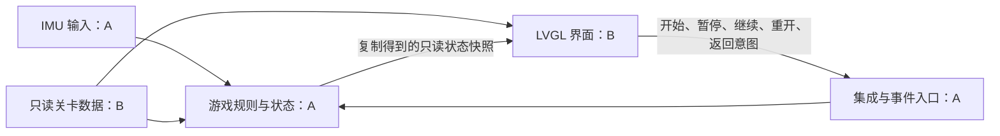

# 体感迷宫：双人协作边界与界面、关卡任务书

- 日期：2026-10-17
- 版本：v0.1，供双方评审的交接草案；不是功能已完成的声明
- 项目负责人：王若豪；另一位成员姓名待补
- 当前基线：`main` 的 `4d9eb23`；T0 启动、串口和 RGB 已有证据
- 阅读顺序：本任务书 → `../../AGENTS.md` → `git-workflow.md` → `../01-需求规格说明.md` 的体感迷宫草案 → `../03-测试计划.md` 的配套用例

> 2026-10-17 更新：王若豪已回复“审阅完毕，选择方案 A，现在开始做”。采用本文三项 A（连续滚动、UI 同线程有界步进、首版单图）；下文 v0.1 待选描述保留为评审历史，以 [方案 A 接口与首轮自检](体感迷宫-方案A接口与首轮自检.md) 和真实公共头文件为当前准则。B 可开始对应模块开发；正式布局和地图由 B 提交评审，不能替 B 编造确认或实测结果。

## 1. 这次交接要完成什么

另一位成员（下称 B）交付“可以显示固定关卡、发送操作意图、显示游戏状态的 LVGL 界面，以及 UI 和游戏逻辑共同使用的关卡数据”。王若豪（下称 A）交付 IMU 输入、校准、运动、碰撞、游戏状态和集成入口。两人各自负责实现、文档、测试、证据和本人提交，不能将一人的工作全部登记到另一人名下。

当前 `src/main.c` 只有串口与 RGB 例程，没有现成游戏、屏幕页面或 IMU 应用模块。当前界面和传感器链路尚未实测，不能按“已经可用”安排任务。SDK 固定为 v2.5.1，板型为 `sf32lb52-lchspi-ulp`；图形界面按课程基线使用 LVGL v9，实际配置与 API 必须核对本地 SDK 和课程示例。

这份文档首先给出工作范围与接口提案。玩法、线程方案、关卡尺寸、操作判据经学生明确选择后，才能冻结相应需求和接口并开始功能实现。B 现在可以阅读资料、画布局、检查环境和评审接口，不能把提案中的数值或结构当成已冻结产品要求。

## 2. 两人职责与文件所有权

下列是建议的新文件名，当前均未创建；新增 C 文件直接放 `src/`，现有 `src/SConscript` 会收集同层 `*.c`，不能擅自改成子目录结构。

| 文件或模块 | 主负责人 | 工作内容 | 另一方怎样参与 |
|---|---|---|---|
| `src/maze_input.c/.h` | A | IMU 初始化、单位转换、归零、方向映射、数据有效性 | B 提供屏幕坐标方向，协助四向测试 |
| `src/maze_game.c/.h` | A | 游戏状态、位置/速度、碰撞、终点、计时、暂停重开、纯逻辑板上自检 | B 按只读快照显示，并交叉测试 |
| `src/maze_ui.c/.h` | B | LVGL 对象、页面切换、绘图、按钮事件、提示和结算 | A 提供快照与事件接收入口 |
| `src/maze_levels.c/.h` | B | 固定地图、起终点、不可变地图描述、地图结构验证 | A 审核可玩性，提供逻辑端读取方式 |
| `src/maze_contract.h` | 双方共管，A 合并 | 状态、快照、意图、关卡描述的共同契约 | 任何字段变更先双方确认，禁止各存一套冲突定义 |
| `src/main.c`、建议的 `src/maze_app.c/.h` | A | 启动顺序、集成、游戏调度、事件投递、故障处理 | B 提交接入说明，不在个人分支重写 main |
| `project/proj.conf`、构建入口和资源接入 | A 统筹 | 依据 SDK 例程接入屏幕、触摸、LVGL、IMU | B 写清依赖和依据，双方评审；受保护骨架规则照常执行 |
| `docs/01`、`02`、`03`、`04` | 各维护本人模块章节 | 需求、设计、用例、实际结果 | 修改前约定章节，避免同时改同一块 |
| 当日 devlog、证据、第三方资源说明 | 各自记录，A 汇总 | 真实问题、AI 采用/纠正、版本与证据关联 | 不能替另一方编造实测或贡献 |

A 对游戏状态与运动数据负责，B 对 LVGL 对象与关卡数据负责。B 不能在绘制函数或按钮回调里实现另一套碰撞、计时和胜利判断；A 不能在 IMU 线程里修改 LVGL 对象。地图由 B 定义为只读数据，A 的逻辑与 B 的界面读取同一份数据。

公共数据类型只在 `maze_contract.h` 定义；`maze_levels.h` 声明取关卡和验证地图的函数，`maze_ui.h` 声明界面入口，不重复定义同名结构。先由 A 整理第一版契约，B 评审后共同冻结，后续变更通过单独提交说明影响。

## 3. 开始实现前必须确认的边界

| 待确认事项 | 方案 A | 方案 B | 建议与影响 |
|---|---|---|---|
| 玩法 | 倾斜控制连续滚动小球 | 倾斜触发按格移动 | 推荐连续滚动，体感更直接；碰撞、抖动和速度限制更复杂。尚未选择 |
| 游戏与 UI 调度 | 游戏每步计算有界，在 UI 所在线程周期调用；IMU 提供受保护快照 | 独立游戏任务，通过有界消息传意图、复制状态快照 | A 同步关系简单，需证明单步不阻塞；B 隔离性好，但有队列、并发与过期消息成本。尚未选择 |
| 首版范围 | 一张固定地图，起终点、暂停继续、通关计时、重开 | 多关卡及选关，可能增加成绩记录 | 推荐先 A，首次联调更早；B 的资源与验收工作更多。尚未冻结 |

在 `ADR-0001`、`docs/02` 与 manifest 中保留提议状态，学生选择后再记已采纳。B 不自行添加陷阱、生命值、随机迷宫、音效、联网排名或断电存档；有想法先作为需求变更讨论。两人的姓名、板卡数量、可借用时段和截止日期仍待补齐。

## 4. 界面从哪里获得数据

建议数据路径如下，模块所有权可先用于评审，任务调度与传输方式尚未冻结：



界面发送“希望执行某操作”，成功投递不等于游戏已经执行。界面必须等下一份状态快照再显示操作结果；投递失败则显示“操作未提交，请重试”，不能直接切到成功页。具体提示语和显示时限待需求评审确认。

### 4.1 契约字段提案

以下是项目自定义接口提案，不是 SDK 现有 API，也不是要求 B 立即创建头文件。

| 数据 | 建议字段 | 单位、语义与所有者 |
|---|---|---|
| 游戏快照 | `run_id`、`revision`、`level_id`、`state` | A 生成；每次新局产生新 run_id，同局 revision 递增。重启后的序号不要求持久化 |
| 小球 | `ball_x`、`ball_y`、`ball_radius` | 建议以地图格为逻辑单位，原点左上，x 向右、y 向下；连续玩法可有小数，格点玩法转换为格心；最终数值类型待确认 |
| 时间 | `elapsed_ms` | A 维护有效游戏时间；UI 仅格式化显示，不按刷新次数自行累计。暂停时间是否排除按最终 PRD 冻结 |
| 传感器状态 | `input_status` | 明确区分未准备、有效、读取失败；详细阈值和恢复规则由 A 提议、双方确认 |
| 错误 | `error_code` | 有界枚举，由 A 定义；B 映射为可读提示，不保存指向临时字符串的指针 |
| 界面意图 | `action`、`expected_run_id`、`request_id` | 操作类型、用户操作所基于的局号、请求号；A 拒绝不属于当前局的迟到操作 |
| 关卡 | `id`、`cols`、`rows`、`cell_count`、`cells`、起点与终点行列 | B 定义；尺寸与数据长度一致，数组生命周期覆盖整局；只读，不被 UI 或逻辑修改 |

`state` 建议至少涵盖准备、校准中、运行、暂停、通关、错误；是否另设主菜单态及失败态待玩法确定。B 将未知状态显示为安全提示，不擅自当作运行。A 提供错误恢复行为，B 只提供按钮与反馈。

### 4.2 建议的 UI 接口形状

```c
/* 提案：类型内容、返回码和签名须双方确认后落入 maze_contract.h。 */
int maze_ui_create(maze_action_sink_t sink, void *context);
void maze_ui_render(const maze_snapshot_t *snapshot,
                    const maze_level_t *level);
void maze_ui_destroy(void);
```

- `create` 仅在 UI 所属线程创建对象，失败返回明确错误，由集成层决定如何处置。
- `render` 在同一 UI 线程调用，快照及关卡已由集成层验证；不能等待 I2C、阻塞收消息或做长计算。相同快照重复调用不重复创建对象。
- 界面只在调用期间读取 snapshot，不保留指向调用者栈内数据的指针。内部如需保存状态，应复制必要字段。
- `sink` 是 A 提供的非阻塞意图入口；接受成功、队列忙、无效意图等返回语义先统一。最终线程方案确定前不假定已有队列或锁。
- `destroy` 释放本模块创建的对象、定时器和回调引用，支持失败后清理与重复进入。UI 自建定时器时，必须与集成层约定唯一刷新入口，不能出现两个游戏推进定时器。
- UI 可记住页面对象和短暂提示；游戏位置、用时、胜负、局号始终以 A 的状态为准。

### 4.3 异步与重复操作

新局使旧局请求失效；同局只接收更新的 revision。投递成功后按钮可显示等待反馈，但只有模型快照确认后才显示暂停、继续或通关。重复开始不能建立两套任务；暂停后重复暂停、结算后重复操作的模型规则由 A 实现，用例先写清楚。编号类型、回绕处理和等待超时是接口冻结清单的一部分，不能只加字段而不定义行为。

## 5. B 的界面任务清单

| 编号 | 任务 | 完成物 | 交付判断 |
|---|---|---|---|
| B-01 | 阅读 SDK v2.5.1 LVGL v9、显示和触摸例程；找到课程 peripheral_lab（路径待提供） | 例程路径、初始化入口、调用线程、所需配置与 API 声明出处清单 | A 能按路径定位；未将其他版本 API 混入项目 |
| B-02 | 画屏幕布局与页面流转草图 | 菜单/校准/游戏/暂停/结算/错误布局，标出游戏区和按钮区 | 以目标屏幕可用区域为依据；不遮挡起终点和操作；先由两人评审 |
| B-03 | 实现静态地图与小球显示 | `maze_ui.c/.h`，最小预览说明 | 墙体、起终点和小球可区分；布局不溢出，目标板照片留证 |
| B-04 | 接入开始、暂停、继续、重开、返回操作 | 控件与意图入口 | 操作按约定投递；失败有提示；不在回调内改变游戏规则 |
| B-05 | 渲染 A 的状态与时间 | 各状态画面及提示 | 校准中不显示假运动；暂停/通关以模型为准；时间来自 elapsed_ms |
| B-06 | 处理异常、销毁与重入 | 清理路径及操作记录 | 重复进入不会叠加回调/定时器；未知/无效数据安全处理；采集错误有反馈 |
| B-07 | 交付与交叉测试 | 提交哈希、复现说明、资源来源、测试与证据 | A 可在自己的工作副本按说明构建接入；未执行的用例标未执行 |

实现目标 B-03 前，必须先经 A 统筹建立显示/触摸/LVGL 的已验证工程配置；B 不通过重写 `SConstruct`、Kconfig 或 `rtconfig.py` 解决接入问题。`proj.conf` 每个新增项先写作用及 SDK 依据。不要复制整个综合测试工程及所有依赖。

游戏区位置、格子像素宽度、按钮大小、字体和刷新频率尚未冻结。B 在 B-02 给出具体布局候选及资源估算；不能把“看起来流畅”当作已完成性能验收。界面刷新只更新变化字段，禁止每帧重建全部对象或动态加载大型资源。

## 6. B 的关卡任务清单

1. 先提供一张固定关卡的二维草图，标记墙、路、起点、终点和预期通路，格子数由双方结合屏幕及小球尺寸选择。
2. 使用纯 C 的不可变数据描述地图；禁止在地图数据头文件包含 LVGL、IMU 或设备驱动头文件。
3. A、B 共同确认格类型编码、行列顺序及越界策略。数组索引建议 `row * cols + col`，总长度显式保存；读取前检查边界，不依赖 UI 裁剪掩盖逻辑越界。
4. 起终点必须在可通行区域内、互不重合；地图必须可达。可达性通过纯逻辑检查验证，不能只看截图。连续玩法还要考虑小球半径与通道净宽，格点可达不自动证明连续小球能通过。
5. B 编写地图结构验证的板上自检：尺寸/长度、起终点合法性、通路等；也要覆盖非法地图。启动输出带用例标识的 PASS/FAIL。A 检查测试逻辑，不为通过而改输入或放宽判据。
6. 地图数据版本变更后，A 重跑碰撞/终点相关回归，B 重跑布局和可达性检查。关卡不在 UI 与逻辑中各复制一份。

## 7. 首次联调前怎样不互相等待

B 可以基于同一契约设计只用于开发预览的固定快照，覆盖准备、校准中、运行、暂停、通关和错误。预览必须明确标“模拟数据”；预览结果不计为 IMU 或整机实测通过。预览入口应独立于生产入口，由 A 接入，禁止 B 新增第二个 `main()`。

A 可先用一张最小地图验证逻辑，但不能把它当作 B 已交付的正式地图。双方首先共同冻结 contract 的字段、单位、状态、函数签名及失败行为，再分别开发模块。合并时检查生产入口未保留假传感器值和预览快照。

## 8. 交付节奏与依赖

| 阶段 | A 要先提供什么 | B 要交什么 | 联调验收 |
|---|---|---|---|
| H0 边界评审 | 玩法/调度备选、输入方向约定 | 布局草图、地图草图、接口反馈 | 双方确认功能范围与契约；ADR 从提议转为已采纳 |
| H1 硬件与静态画面 | 最小显示/触摸配置、编译入口；IMU 关键链路验证 | 一张地图、静态小球、可操作按钮 | 学生提供屏幕与触摸真实证据，不以主机预览替代 |
| H2 第一次贯通 | 真实输入快照、意图处理、最小运动状态 | 用真实快照显示运动、暂停/继续 | 四向对应、显示与模型一致；出现错误可定位 |
| H3 完整一局 | 碰撞、终点、计时、校准与错误恢复 | 结算、重开、错误与重入 | 从开始玩到通关，再重开；边界与回归用例执行 |
| H4 交接 | 集成版本和构建说明 | 本人模块说明、测试证据、来源清单 | 双方互相复现，填实际用时与结果，不提前填 PASS |

日期和估时由两人根据课表、硬件借用情况确认，本任务书不编造排期。只有一块板时，按 H1/H2/H3 预约上板窗口；另一人先做文档、逻辑自检设计或明确标记的预览，两人仍需分别完成本人实测。

## 9. B 的验收与证据要求

配套用例在 `docs/03` 的 TC-201～TC-208。最低交付清单：

- [ ] 屏幕上墙、通路、起点、终点、小球清楚可辨；布局由真实板端照片核对。
- [ ] 显示坐标与地图逻辑一致；顶部/左侧/右侧/底部定位按用例检查，避免轴反向或比例不一致。
- [ ] 开始、暂停、继续、重开、返回发出正确意图，模型未确认时不显示已完成。
- [ ] 用时直接来自快照；暂停和通关显示遵守最终确定的计时规则。
- [ ] 过期快照、旧局意图、投递忙、输入错误、非法地图有清楚处理，系统不崩溃。
- [ ] 地图结构与可达性板上自检输出 PASS/FAIL；连续玩法追加半径与通道适配验证。
- [ ] 重复进入、退出、重开有实测记录；循环次数、持续时长及资源观测方法先由两人确认再执行，不能据一次演示声称稳定。
- [ ] 运行 `python scripts/build_firmware.py`，保留首条错误和完整输出；成功不等于实物通过。
- [ ] 原始截图、串口日志及测试记录带对应提交、板型、SDK、步骤、预期、实际、执行人；大视频另提供可访问归档位置，不强制加入 Git。
- [ ] 每次交付标明通过/失败/未执行，失败保留并追加重测；未执行项登记原因和责任人。

建议证据目录为 `evidence/M2/maze_ui/`（首次显示/触摸和关键链路）与 `evidence/M3/maze_ui/`（完整功能）；具体文件以实际验证日期命名。没有真机时，B 交付明确说明未验证的代码和编译结果，不能填写物理通过。

## 10. Git 与集成约定

1. 两人从同一远程仓库克隆，使用各自真实姓名与邮箱提交；B 在自己的克隆中配置身份，不覆盖 A 的本地身份。
2. 开工执行 `git status`，确认无未处理改动后 `git switch main`、`git pull --ff-only`。以已确认需求编号创建个人功能分支，例如 `feat/req-201-maze-ui`；地图可用 `feat/req-204-maze-levels`。
3. 不同时编辑 main、共同头文件或相同文档章节。B 在 PR/交接说明列出接口及配置需求，A 审核集成；冲突按真实内容解决，不整文件覆盖。
4. 代码与用例按小步提交；每个提交写课程要求的背景/改动/验证/AI协作。AI 帮忙实现也必须写本人实际理解、纠正和验证情况。学生先读过提交信息并确认再提交。
5. 提交前检查差异，运行追踪检查、构建及本模块用例；更新本人当天日志。`hw(...)` 用于实际板端证据归档，不以 docs 提交伪装硬件通过。
6. 提交前排除凭据、固件产物和大视频。A 合并后再检查跨模块回归；合并策略沿用课程 Git 规范，不强推共享 main。

## 11. B 每次交付时粘贴这份说明

```text
分支 / 提交：
负责的需求和用例：
改了哪些文件：
接入前提（SDK、配置、契约版本）：
A 如何调用 / 如何复现：
构建命令与实际结果：
板上自检与真机结果（通过 / 失败 / 未执行）：
原始证据路径：
未解决问题、对 A 的依赖：
第三方资源来源、版本、许可与修改：
AI 参与与本人修正 / 验证：
```

## 12. 评审后才能开始实现的检查点

- [ ] 补 B 姓名、板卡数量和各自可用时间。
- [ ] 两人明确选择玩法、线程方案和首版范围，确认 ADR。
- [ ] 双方确认事件表、快照字段、地图编码、坐标/单位与接口签名。
- [ ] B 提交布局和关卡草图；A 核对碰撞所需的小球半径与通道宽度。
- [ ] 两人确认 REQ-201～REQ-208 和 TC-201～TC-208 的草案，补足具体测量方法与次数。
- [ ] 屏幕、触摸、IMU 示例来源和配置项都有本地 SDK 依据。

AI 协作记录：本任务书由 Codex / GPT-6 按学生“先确定协作边界并详细整理另一位成员任务”的要求起草。B 姓名、具体玩法和调度均未收到明确选择；不能将本文写成两位成员已经确认的设计。
