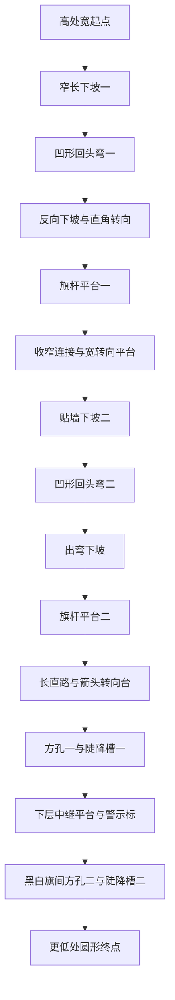

# 第二关：完整参考录像拆解

负责人纠正：“参考整段录像，观察仔细一点”。本次按完整路线修正理解，撤回此前把回头弯与落台分成 A/B 二选一的建议。二者实际在同一条路线里先后出现。本文替代此前路线提案的简化草案；不是几何实现或接口修改已获批准的记录。

## 查看方法与证据

源：`C:/Users/23396/Downloads/11月10日(1).mp4`，1920×1080、30fps、771帧、时长25.704秒。完整覆盖0～25.5秒，每0.5秒提取一帧共52帧，分四张联系图实际查看；另外对15.5～20秒按每秒6帧复核两个陡降连接，避免把洞口/槽底的遮挡看成普通跳台。

关键帧见 [完整路线十二图](../../evidence/M4/level2-planning-2026-11-13/full-route-keyframes.png)。从左到右、从上到下的源视频取样时间为：3.5 / 5 / 7 / 9.5 / 11 / 13 / 15 / 16 / 17.5 / 18.5 / 19.5 / 20.5 秒。取样基于先转换为2fps的时间序列，非画面中的游戏倒计时。另保存 [陡降细查](../../evidence/M4/level2-planning-2026-11-13/chutes-detail.png)。这些是参考游戏画面，不能登记为本工程实机证据。

## 实际路线顺序

| 源录像约时 | 直接可见的结构与球路 | 第二关应保留的体验 |
|---|---|---|
| 0～3s | 高处宽起点，绿色圆形出生标记；倒计时/GO；背景有高低方柱与棋盘顶面 | 从高处出发，开局前能预览旁边低层道路 |
| 3～4.5s | 球驶离宽台，经红色下坡箭头进入窄长坡，沿厚高台侧面下降，外缘有低护边 | 宽转窄，明确下坡方向和高差 |
| 4.5～5.5s | 第一处半圆回头弯，棋盘曲面和内侧分隔体清楚可见；球沿弯改变方向 | 第一组下坡—凹形回头弯，弯有真实承载剖面 |
| 5.5～7.5s | 出弯沿另一侧继续下坡，再直角转向进入较宽、带黄色旗杆和大箭头的平台 | 回头后仍有下坡和转向；旗杆是路径地标 |
| 7.5～9.5s | 沿平台的长箭头前进，经收窄连接到另一个宽平台，前方外沿/方向改变处带护边 | 宽台—窄连接—宽台的节奏，不能直接缩成一段直坡 |
| 9.5～10.5s | 宽平台尽头拐向另一条贴高墙的窄下坡，前方可看见第二处曲面回头弯 | 第二组下坡入口与第一组分开、处在更低高度 |
| 10.5～11.5s | 第二处半圆回头弯，内侧分隔岛、外侧曲面及棋盘连续变化可见 | 完整参考有两个独立弯，不能只画一个弯代表整关 |
| 11.5～13s | 出弯接斜坡下降到第二个黄色旗杆/箭头平台，球附近一度出现星状反馈 | 第二个明显路线地标；不凭旗杆外形断言其存档机制 |
| 13～15.5s | 沿长平台/窄直线前进，旁边是很高的立面；尽头较宽平台有弯曲红箭头，导向边缘方孔 | 直线后再调整方向、对准洞口，空间高度进一步下降 |
| 15.5～17s | 球进入白色边框方形开口后消失于遮挡；外侧能看见橙红色近竖直陡降槽、白框出口；随后球出现在低层宽平台 | 这是洞口—陡降槽—下层承接，不是平坡跨缝或普通自由跳台 |
| 17～18.5s | 下层宽平台有黄色感叹号圆标、两边低栏和边缘黑白旗；球从槽口附近横穿平台驶向旗间另一处方孔 | 下层平台是中继段，不是终点；还需一次对准与转向 |
| 18.5～20s | 从第二方孔再进另一段陡降槽，球在出口附近重新可见，落到更低的圆形GOAL台 | 两次独立陡降分层；最后才是圆形承接终点 |
| 20～25.704s | 终点变绿、出现完成反馈，球仍运动；随后结果/奖励浮层及淡出 | 终点后的自然滚动和结算可复用现有交互 |

这里的时间为粗略路段界线，不是逐帧接触时刻。遮挡期间的球路与内部碰撞形状不可从单视角直接还原；不推断是否有隐藏管道、特殊推力或其他机制。黄色旗杆有两处，但录像没有展示死亡复活，无法确认其存档语义。黄色感叹号也不能直接当成检查点。

## 路线结构图（拓扑，不是测量尺寸或俯视坐标）

## 造型与可读性

棋盘路面、大箭头、低护边和实体内侧分隔体共同描述球路。道路由厚重台体/高墙支撑，远处高低方柱形成纵深；不是若干悬空薄板。弯道应看得出凹面和内外缘。两段相近的回头弯通过高度、地标和后续路线区别。方孔有明显浅色边框，陡降槽用不同颜色与棋盘路分开，低层落地面足够宽。旗门与最终GOAL台也要区别于中继平台。

新地图继续沿用本工程粉紫棋盘与英文HUD；参考整体空间结构和路段节奏，不从视频复用角色、品牌或美术资源。参考颜色中的橙色高墙可在本工程中转成深紫台体，浅棋盘顶面与绿色终点保持功能对比。

## 与932a8d0接口的真实差距

1. `r3_world_t`目前只有一个`const r3_bend_t *bend`。生产校验器、碰撞和渲染均按一个弯处理。完整路线的两个独立回头弯不能只增加第二张装饰网格；需要A扩展多弯接口与生产处理，或明确接受折线近似，后者会损失录像主要特征。此前推荐的单弯9盒草案不代表完整参考，撤回该预算承诺。
2. 当前只有一个检查点。两个旗杆可先作为两处视觉地标，选一处作实际检查点；不能声称已经支持两个存档。如需复现多个检查点，由A扩展，不擅改session/runtime。
3. 两个陡降槽可以先研究用现有OBB组成入口、陡坡、出口过渡和接球平台；是否能保证连续碰撞、落地稳定和高速预算，要算真实尺寸并测试，不以画面相似认定可行。方孔必须用分离承载盒留出真实孔口，不能在完整承载面上贴一个橙色方块假装有洞。
4. 完整路线的路、孔边、转向护边、陡降导槽和终点护栏都占16盒预算。必须逐件核算，不能把可站/可挡的墙全转成无碰撞装饰。当前没有足够依据承诺16盒内完整还原，先做几何预算再提出必要资源需求。
5. 圆形终点在当前只有OBB与半环曲面时也不能仅画圆贴图就声称有圆形边界碰撞；需要明确承载外形适配，交A与负责人审阅。

B当前先交完整路线拓扑、地标/高度关系、碰撞预算与接口需求，再落REQ/TC及选定的技术方案。保持M1/M2/M3、物理核心、镜头和生产入口原样。负责人已要求参考整段录像，后续不再把路线内容拆成“只做回头弯或只做落台”的选择。

## 后续验收需要覆盖

两个回头弯分别进出、曲面与直坡接缝、两次方孔进入/陡降/出槽/承接、低层中继平台横穿、最终终点顶面接触与自然滚动。连续回放从出生开始仅施加输入，不通过逐段传送拼接通关。检查点语义、圆形终点适配及新增接口须明确后固定判据。原0.5/2/5/7.5m/s边缘/护栏回归、求解预算、100/50行一致性和内存限制保持；没有新代码与固件、也没有新真机通过结论。
